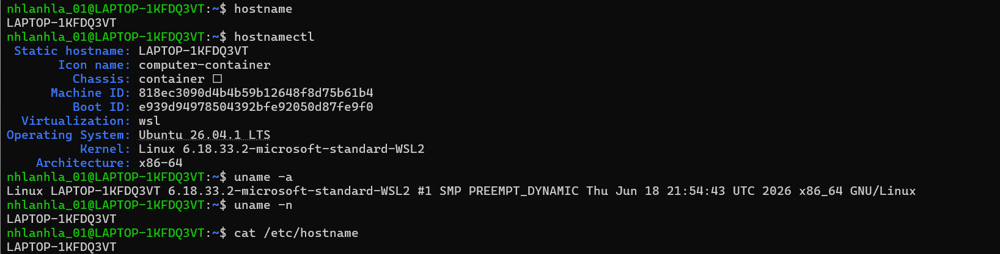
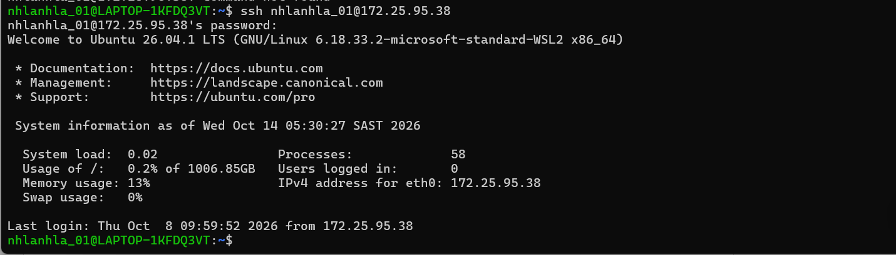
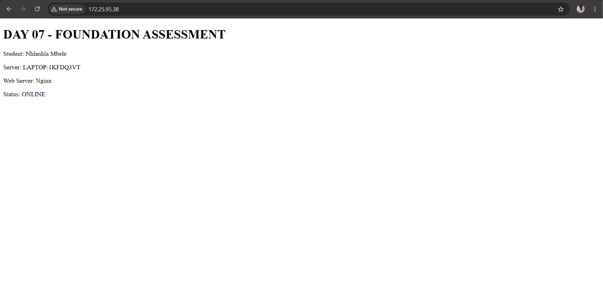
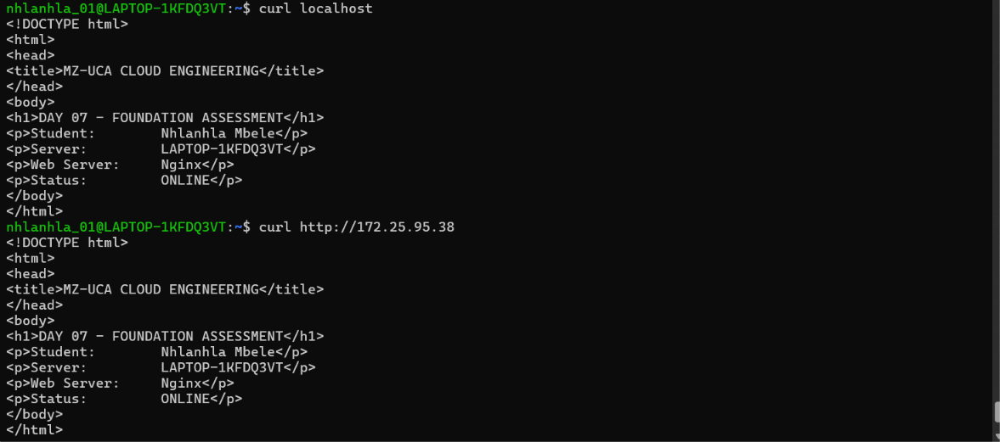
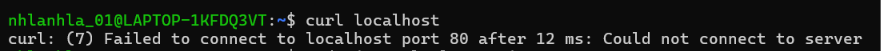
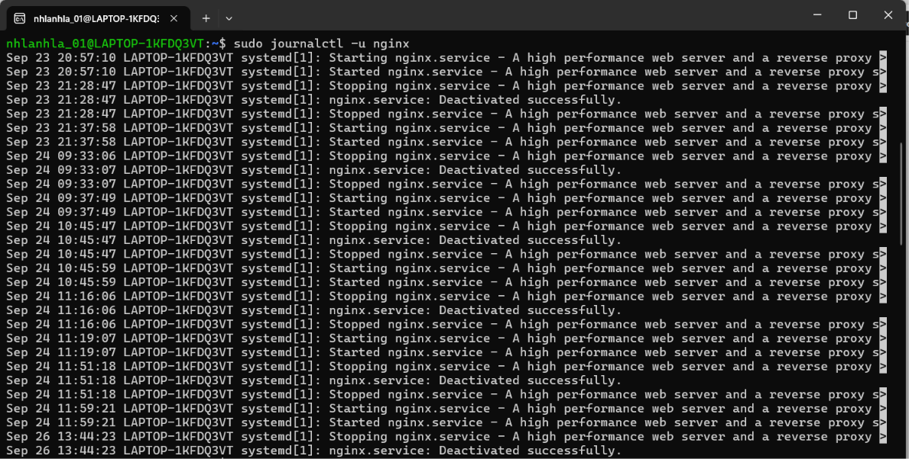
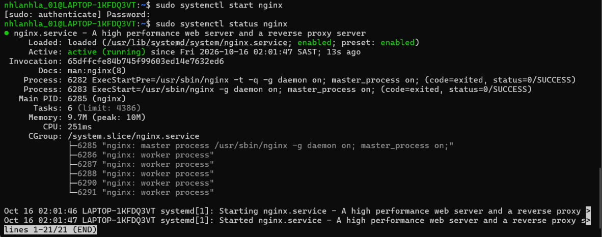

# MZ−UCA Cloud Engineering
## Day 07 − Foundation Assessment

## Student 
-Nhlanhla Fortunate Mbele

## Objective 
What was the engineering challenge?
-Prepare a Linux server to host a basic web application.
ACCESS -> INSPECT -> CONFIGURE -> DEPLOY -> VERIFY -> TROUBLESHOOT -> RECOVER -> DOCUMENT -> COMMIT -> PUSH
-Troubleshooting a controlled failure

## Environment a controlled failure involving the Nginx service. 
What operating system and tools were used?
-Static hostname: LAPTOP-1KFDQ3VT
-Virtualization: wsl
-Operating System: Ubuntu 26.04.1 LTS
-Kernel: Linux 6.18.33.2-microsoft-standard-WSL2
-Architecture: x86-64

## Architecture 
Explain the solution.
-The local machine(computer) must access the web browser through SSH to access web content using http TCP port 80 and 22. 

## Deployment 
Explain how Nginx was deployed.
The following commands were used to deploy Nginx:
-sudo apt update
-sudo apt install nginx -y
the nginx service uses SSH to access web browser through http, using .the following command: ssh username@SERVER-IP. 

## Verification 
Explain how the application was tested.
-The command sudo systemctl status nginx to check the status of the application. It is to ensure

## Failure 
Simulation Explain what was intentionally broken.
The nginx service was stopped using the command:sudo systemctl stop nginx. The Nginx service breaks HTTP traffic. The HTTP requests will immediately fail with error message "Connection refused" or "Site can't be reached".

## Troubleshooting 
Explain your investigation.
The following were inspected:
-Firewall rules
-Network ports
-Nginx status

## Recovery 
Explain how the service was restored.
-The nginx was restarted to make the server active(running).

## Evidence 
Provide links to relevant evidence.

## Lessons Learned 
What did you learn?
-Use troubleshooting methods to troubleshoot the nginx service
-Identify your environment before making changes.
-do not randomly use commands, know what you are doing.

## Engineering Reflection
What would you improve if this were a production environment?
-Use CloudWatch to identify errors, to report if the nginx service is inaccessible.
